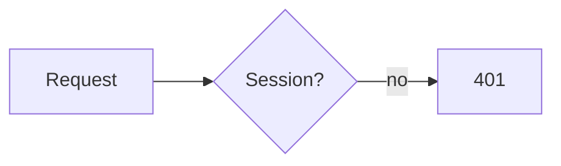

# rex-web

`rex-web` shows a page in a Rex pane next to yours, in the Rex theme. Use it
only in Rex (`$REX_BLOCK` is set), and only when a visual explains better than
text: diagrams, results tables, comparisons, previews, or a choice made with a
click. Not for short answers or code the user will copy. Close the pane when
the user is done with it.

Two engines; `show` picks one:
- **tui** (preferred: fast, light, selectable text): Markdown, Mermaid, and
  plain question forms, drawn as terminal text. Used for `.md` files,
  Markdown on stdin, and HTML with only plain elements and the kit classes.
- **web** (headless Chrome): anything else: `<script>`, `<style>`, `style=`,
  images, SVG, charts, other classes. Live: click, type, scroll, hover.

Write Markdown or a plain form when it's enough.

## Commands

```bash
rex-web show notes.md              # open the pane, or replace its page (no focus change)
rex-web show - <<'EOF'             # stdin: Markdown, or HTML if it starts with <
# Hello
EOF
rex-web show --below --ratio 40 f  # where to open the pane (only when it opens)
rex-web show --focus f             # give the pane focus (before the user types in it)
rex-web show --engine web f        # force an engine: tui or web (web can't draw .md)
rex-web shot [-o out.png]          # web: PNG; tui: the pane's text (.txt). Prints the path
rex-web eval 'document.title'      # web only: run JS in the page, print the result as JSON
rex-web wait [--timeout S] [--close]  # wait for the page to send a value; print it as JSON
rex-web hide                       # close the pane
rex-web status                     # JSON: open, engine, url, size
```

- One viewer per agent pane; `show` again replaces its page. `--name NAME`
  keeps a second viewer.
- Local files reload when they change: write `/tmp/rex-web-<topic>.md`,
  `show` it once, then edit it.
- After `show`, run `shot` and read the result before you tell the user.
  Fix cut-off or empty content. Web pages that render after load need a
  second or so.

## Markdown (tui)

GitHub-flavored Markdown with highlighted code; a ```` ```mermaid ```` block
becomes a diagram in the theme's colors. The page scrolls (wheel, PgUp/PgDn,
g/G). Keep tables narrow (the pane is often 60 to 100 columns).

````markdown
# Benchmark results

| Test | Before | After |
|---|---:|---:|
| parse | 120 ms | 84 ms |


````

## HTML

Write a semantic fragment (no `<html>`, `<head>`, or page background). A base
style themes `h1`, `p`, `table`, `code`, `pre`, `button`, `input`, `select`,
`hr`. Kit classes (tui draws all of them):

`card`, `grid`, `row`, `stack`, `spacer`, `muted`, `stat` (with `.label`,
`.value`), `badge` (plus `red` `green` `yellow` `blue` `magenta` `cyan`),
`choice` (option card), `button.primary`, `button.danger`, `pre.mermaid`.
Web only: `bar` (`style="--v: 64%"`), `add`/`del` (diff lines).

Web pages:
- Theme colors are CSS variables: `--rex-bg`, `--rex-fg`, `--rex-accent`,
  `--rex-muted`, `--rex-border`, `--rex-surface`, `--rex-subtle`,
  `--rex-red`…`--rex-cyan`, `--rex-0`…`--rex-15`. Use them, not fixed colors.
- Scripts get the same in `rex.theme` (plus `dark`); `rex:theme` fires on a
  theme change. Libraries load from a CDN (Chart.js, Mermaid): take their
  colors from `rex.theme` and turn off animation.
- The pane is 600 to 1300 px wide: let content wrap. Keep pages still;
  constant animation costs CPU.
- `rex.copy(text)` (clipboard), `rex.close()`, `rex.title(text)`.

## Ask the user

`<form data-rex>` sends its fields as an object on submit; `rex.send(value)`
(web) sends any JSON value. The submit button's `name`/`value` replaces the
field of that name, so several buttons can give different answers. Repeated
names become arrays. `required` is checked, except for a named button.

In tui, radios and `<select>` are option cards, checkboxes toggle, `<input>`
and `<textarea>` take text. Keys: Tab/arrows/j/k move, Space toggles, Enter
or a click submits, Alt+Enter adds a line.

```bash
rex-web show - <<'EOF'
<h1>Which database?</h1>
<form data-rex>
  <label class="choice"><input type="radio" name="db" value="postgres" checked>
    <div><b>Postgres</b><small>Mature, JSONB, extensions</small></div></label>
  <label class="choice"><input type="radio" name="db" value="sqlite">
    <div><b>SQLite</b><small>Zero ops, one file</small></div></label>
  <div class="row"><button type="submit">Continue</button><button name="db" value="none">Neither</button></div>
</form>
EOF
rex-web wait --timeout 600 --close   # prints {"db":"sqlite"}
```

- Tell the user in text that a question waits in the pane.
- Run `wait` in the background if you can. It exits 124 on timeout and 3 if
  the user closed the pane; then ask in text.
- `--close` closes the pane after the answer or the timeout.
- Put the question and its buttons first; the pane can be short.
- Values sent before `wait` starts are kept until the next `show`.

## Troubleshooting

- `no open viewer`: `show` first; the user may have closed the pane.
- `rex split failed`: report it and answer in text. Don't rearrange panes.
- A tui page drawn badly: `show --engine web` it (HTML only).
- Debug log: `REX_WEB_DEBUG=/tmp/rex-web.log rex-web show ...`.
