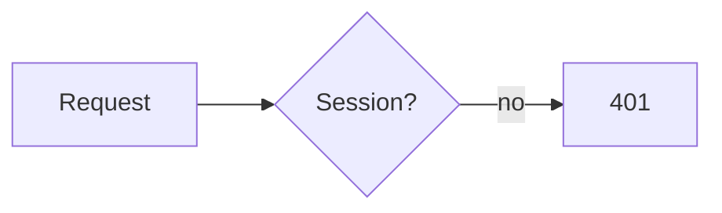

# Visualise

Show the user things in a Rex pane next to yours with `rex-view`. Use it only
in Rex (`$REX_BLOCK` is set), and only when seeing beats reading:

- **Explain:** architecture, data flow, a state machine, a sequence (Mermaid).
- **Results:** benchmarks, test or coverage numbers, tables too wide for chat.
- **Compare:** options side by side, before and after.
- **Preview:** a UI component, colors, rendered docs.
- **Explore:** a live tool where the user changes inputs and sees the result
  (a pricing calculator, a cost or capacity model, a config builder), instead
  of a table of every case.

Not for short answers or code the user will copy. Tell the user in text what
the pane shows, and close it when they are done with it.

Two engines; `show` picks one:
- **tui** (preferred: fast, light, selectable text): Markdown, Mermaid, plain
  HTML forms, and live `data-expr` tools, drawn as terminal text. Used for
  `.md` files, Markdown on stdin, and HTML with only plain elements and the
  kit classes.
- **web** (headless Chrome): anything else: `<script>`, `<style>`, `style=`,
  images, SVG, charts, other classes. Live: click, type, scroll, hover.

Write Markdown when it's enough; for a live tool, use `data-expr` formulas
(both engines). Use scripts only when formulas can't do it.

## Commands

```bash
rex-view show notes.md              # open the pane, or replace its page (no focus change)
rex-view show - <<'EOF'             # stdin: Markdown, or HTML if it starts with <
# Hello
EOF
rex-view show --below --ratio 40 f  # where to open the pane (only when it opens)
rex-view show --focus f             # give the pane focus (before the user types in it)
rex-view show --engine web f        # force an engine: tui or web (web can't draw .md)
rex-view shot [-o out.png]          # web: PNG; tui: the pane's text (.txt). Prints the path
rex-view eval 'document.title'      # web only: run JS in the page, print the result as JSON
rex-view wait [--timeout S] [--close]  # wait for the page to send a value; print it as JSON
rex-view hide                       # close the pane
rex-view status                     # JSON: open, engine, url, size
```

- One viewer per agent pane; `show` again replaces its page. `--name NAME`
  keeps a second viewer.
- Local files reload when they change: write `/tmp/rex-view-<topic>.md`,
  `show` it once, then edit it as the work goes on.
- After `show`, run `shot` and read the result before you tell the user.
  Fix cut-off or empty content. Web pages that render after load need a
  second or so.

## Markdown (tui)

GitHub-flavored Markdown with highlighted code; a ```` ```mermaid ```` block
becomes a diagram in the theme's colors. The page scrolls (wheel, PgUp/PgDn,
g/G). Keep tables narrow (the pane is often 60 to 100 columns).

````markdown
# Benchmark results

| Test | Before | After |
|---|---:|---:|
| parse | 120 ms | 84 ms |


````

## HTML

Write a semantic fragment (no `<html>`, `<head>`, or page background). A base
style themes `h1`, `p`, `table`, `code`, `pre`, `button`, `input`, `select`,
`hr`. Kit classes (tui draws all of them):

`card`, `grid`, `row`, `stack`, `spacer`, `muted`, `stat` (with `.label`,
`.value`), `badge` (plus `red` `green` `yellow` `blue` `magenta` `cyan`),
`choice` (option card), `button.primary`, `button.danger`, `pre.mermaid`.
Web only: `bar` (`style="--v: 64%"`), `add`/`del` (diff lines).

Web pages:
- Theme colors are CSS variables: `--rex-bg`, `--rex-fg`, `--rex-accent`,
  `--rex-muted`, `--rex-border`, `--rex-surface`, `--rex-subtle`,
  `--rex-red`…`--rex-cyan`, `--rex-0`…`--rex-15`. Use them, not fixed colors.
- Scripts get the same in `rex.theme` (plus `dark`); `rex:theme` fires on a
  theme change. Libraries load from a CDN (Chart.js, Mermaid): take their
  colors from `rex.theme` and turn off animation.
- The pane is 600 to 1300 px wide: let content wrap. Keep pages still;
  constant animation costs CPU.
- `rex.copy(text)` (clipboard), `rex.close()`, `rex.title(text)`.

### Live tools

Give each input a `name`, and put a formula in `data-expr` on any element
(`<output>`, `<span>`, `.value`): it shows the result and updates as the user
moves a slider, ticks a box, or types. No script, so it opens in the light
tui engine; Chrome evaluates the same formulas.

- Formulas use the inputs' names: numbers (`seats`), a lone checkbox is
  `true`/`false`, a checkbox group is a list, a radio or `<select>` is the
  picked value. Constants go in `<input type="hidden" name="base" value="49">`.
- Operators: `+ - * / % **`, `== != < <= > >=`, `&& || !`, `a ? b : c`,
  `'text'`. Functions: `money(x, '$', decimals)`, `pct(x)`, `fmt(x, decimals)`,
  `round(x, n)`, `min`, `max`, `clamp(x, lo, hi)`, `abs`, `floor`, `ceil`,
  `sqrt`, `pow`, `has(list, v)`, `count(list)`.
- Show the parts of the result, not only the total, so the user can check the
  math. tui keys: Tab moves, ←/→ steps a slider (shift: ×10), Space toggles.

```html
<meta charset="utf-8">
<h2>Price estimate</h2>
<form data-rex>
  <label>Seats <input type="range" name="seats" min="1" max="200" value="20"></label>
  <label><input type="checkbox" name="annual" checked> Annual billing (−15%)</label>
  <select name="plan"><option value="12">Team ($12)</option><option value="20">Business ($20)</option></select>
  <input type="hidden" name="base" value="49">
</form>
<div class="stat"><span class="label">Per month</span>
  <span class="value" data-expr="money((base + seats * plan) * (annual ? 0.85 : 1))"></span></div>
<p class="muted"><output data-expr="money(base)"></output> base + <output data-expr="seats"></output> ×
  <output data-expr="money(plan)"></output><output data-expr="annual ? ' − 15%' : ''"></output></p>
```

A page that needs more (charts, loops, data from a file) uses a `<script>`
and opens in Chrome. Start files you write with `<meta charset="utf-8">`.

## Getting a value back

A page can send the user's choice back to you: the settings they landed on in
a live tool, or a pick between options you showed. `rex-view wait` blocks until
it arrives and prints it as JSON.

- In a live tool, a submit button (`<button type="submit">Use this</button>`)
  sends the inputs' current values. `rex.send(value)` (web) sends any JSON value.
- `<form data-rex>` sends its fields as an object on submit (tui and web).
  The submit button's `name`/`value` replaces the field of that name, so
  several buttons can give different answers. Repeated names become arrays.
  `required` is checked, except for a named button.

In tui, radios and `<select>` are option cards, checkboxes toggle, `<input>`
and `<textarea>` take text. Keys: Tab/arrows/j/k move, Space toggles, Enter
or a click submits, Alt+Enter adds a line.

```bash
rex-view show - <<'EOF'
<h1>Which database?</h1>
<form data-rex>
  <label class="choice"><input type="radio" name="db" value="postgres" checked>
    <div><b>Postgres</b><small>Mature, JSONB, extensions</small></div></label>
  <label class="choice"><input type="radio" name="db" value="sqlite">
    <div><b>SQLite</b><small>Zero ops, one file</small></div></label>
  <div class="row"><button type="submit">Continue</button><button name="db" value="none">Neither</button></div>
</form>
EOF
rex-view wait --timeout 600 --close   # prints {"db":"sqlite"}
```

- Tell the user in text that the pane waits for them.
- Run `wait` in the background if you can. It exits 124 on timeout and 3 if
  the user closed the pane; then ask in text.
- `--close` closes the pane after the value arrives or the timeout.
- Put the choice and its buttons first; the pane can be short.
- Values sent before `wait` starts are kept until the next `show`.

## Troubleshooting

- `no open viewer`: `show` first; the user may have closed the pane.
- `rex split failed`: report it and answer in text. Don't rearrange panes.
- A tui page drawn badly: `show --engine web` it (HTML only).
- Debug log: `REX_VIEW_DEBUG=/tmp/rex-view.log rex-view show ...`.
